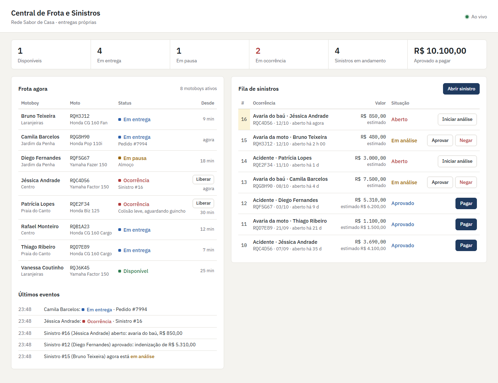
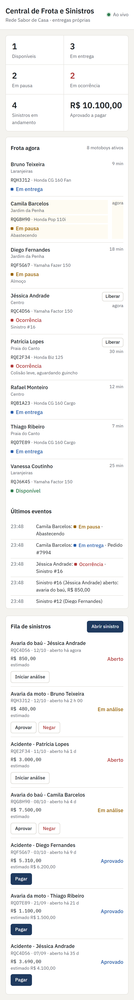

# Frota e Sinistros em tempo real

Central de uma rede de restaurantes com entrega própria: o **status de cada motoboy aparece ao vivo** (disponível, em entrega, em pausa, em ocorrência) e os **sinistros da frota** (acidente, roubo, avaria da moto ou do baú) seguem um fluxo controlado até o pagamento da indenização pelo seguro.

Feito com **C#, ASP.NET Core 8, SQL Server 2022, Entity Framework Core 8, SignalR e xUnit**. A regra que muda dinheiro e status fica no banco, em procedures T-SQL com transação e `TRY/CATCH`; o domínio em C# foi escrito em TDD.



## Por que este projeto existe

O tema vem do **Rende**, o sistema de pedidos para restaurantes que desenvolvo: quem tem entrega própria tem motoboy na rua, e moto na rua tem acidente, roubo e avaria. O que interessa aqui é o miolo de qualquer sistema de seguros:

- um **fluxo de status com regras** (`Aberto → EmAnalise → Aprovado | Negado`, `Aprovado → Pago`) que não pode ser burlado;
- **dinheiro que não pode sair duas vezes**, mesmo com cliques ou integrações simultâneas;
- **auditoria** de toda mudança;
- **sustentação**: scripts de ajuste de base feitos do jeito seguro.

## Stack

| Camada | Tecnologia |
| --- | --- |
| Banco | SQL Server 2022: tabelas com PK/FK/UNIQUE/CHECK, índices, 3 views, 3 procedures T-SQL |
| API | ASP.NET Core 8 (controllers), Swagger em `/swagger`, ProblemDetails para erros |
| Acesso a dados | EF Core 8 para leitura, cadastro e views; `ExecuteSql`/`ExecuteSqlRaw` parametrizado para as procedures |
| Tempo real | SignalR (`/hubs/frota`) + simulador de status opcional (`BackgroundService`) |
| Front | Página estática servida pela API (HTML, CSS e JS puro, cliente SignalR via CDN) |
| Testes | xUnit: 39 unitários do domínio (TDD) e 17 de integração com SQL Server real (`WebApplicationFactory`) |
| Infra | Docker Compose (SQL Server + API, perfil de teste), Dockerfile multi-stage, GitHub Actions |

## Como rodar

Requer Docker. Para rodar fora do Docker, .NET 8 SDK.

### Tudo em Docker

```bash
cp .env.example .env
docker compose up -d --build
```

Painel em `http://localhost:5080`, Swagger em `http://localhost:5080/swagger`. Na primeira subida a API cria a base `SinistrosFrota` e aplica os scripts de `database/` (schema, views, procedures e seed com 8 motoboys e 15 sinistros dos últimos meses). O simulador de status vem ligado no compose.

O SQL Server fica exposto na porta **14330** (usuário `sa`, senha do `.env`), para abrir no SSMS/Azure Data Studio: `localhost,14330`.

### API local com `dotnet run`

```bash
cp .env.example .env
docker compose up -d sqlserver
dotnet run --project src/SinistrosFrota.Api
```

Sem `ConnectionStrings__SinistrosDb` definida, a API monta a connection string a partir do `.env` (senha e porta), então a senha não fica repetida em `appsettings`.

### Testes

```bash
# unitários (não precisam de banco)
dotnet test tests/SinistrosFrota.Tests

# integração: sobe um SQL Server descartável na porta 14331
docker compose --profile test up -d sqlserver-test
dotnet test tests/SinistrosFrota.IntegrationTests

# ou tudo de uma vez
dotnet test
```

Os testes de integração apagam e recriam a base `SinistrosFrotaTestes` a cada execução. Para apontar para outro servidor, defina `SINISTROS_TEST_CONNECTION`.

## Endpoints

| Método | Rota | O que faz |
| --- | --- | --- |
| GET | `/api/motoristas` | Quadro da frota (view `vw_MotoristasStatusAtual`) |
| GET | `/api/motoristas/{id}` | Status atual de um motoboy |
| POST | `/api/motoristas` | Cadastra motoboy com a moto (409 se CPF ou placa já existem) |
| PUT | `/api/motoristas/{id}/status` | Novo status do motoboy, enviado ao vivo pelo SignalR |
| GET | `/api/sinistros?status=&motoristaId=&pagina=&tamanho=` | Lista paginada |
| GET | `/api/sinistros/em-aberto` | Fila de trabalho (view `vw_SinistrosEmAberto`) |
| GET | `/api/sinistros/{id}` | Detalhe com histórico de status |
| POST | `/api/sinistros` | Abre sinistro (`sp_AbrirSinistro`); 422 se a apólice não estava vigente |
| POST | `/api/sinistros/{id}/transicoes` | `{ "novoStatus": "EmAnalise" \| "Aprovado" \| "Negado", "valorApurado"? }` (`sp_AlterarStatusSinistro`); 409 se a transição não é permitida |
| POST | `/api/sinistros/{id}/pagamento` | Paga a indenização (`sp_PagarSinistro`); 409 se já foi pago |
| GET | `/api/apolices?motoristaId=` | Apólices e se estão vigentes hoje |
| GET | `/api/relatorios/sinistros-por-mes?meses=6` | Resumo mensal por tipo (view `vw_ResumoSinistrosPorMes`) |
| GET | `/health` | API e banco |

Exemplo de erro (sempre `application/problem+json`):

```json
{
  "type": "https://httpstatuses.io/409",
  "title": "Transição de status inválida",
  "status": 409,
  "detail": "Transição de Aberto para Aprovado não é permitida.",
  "codigo": "transicao_invalida"
}
```

Eventos do hub `/hubs/frota`: `StatusMotoristaAlterado` (linha da view da frota) e `SinistroAtualizado` (`{ evento, sinistro }`).

## O banco

```
database/
  01_schema.sql        tabelas, constraints, índices (idempotente)
  02_views.sql         vw_MotoristasStatusAtual, vw_SinistrosEmAberto, vw_ResumoSinistrosPorMes
  03_procedures.sql    sp_AbrirSinistro, sp_AlterarStatusSinistro, sp_PagarSinistro
  04_seed.sql          dados de demonstração (só se a base estiver vazia)
  ajustes/
    ajuste_01_corrigir_valor_estimado.sql
    ajuste_02_reabrir_sinistro_negado.sql
    ajuste_03_expurgo_status_motorista.sql
```

Tabelas: `Motoristas`, `Veiculos`, `Apolices`, `Sinistros`, `SinistroHistorico` (auditoria), `StatusMotorista` (log de status) e `TransicoesSinistro` (as transições permitidas como dado).

Além de PK e FK, os `CHECK`s garantem coerência entre colunas: só sinistro `Pago` tem `PagoEm`, todo `Aprovado`/`Pago` tem `ValorIndenizado`, e `Status`/`Tipo` só aceitam os valores do domínio.

## Decisões técnicas

**Regra em duas camadas.** O domínio em C# (`SinistrosFrota.Domain`, sem dependência de banco) valida a transição antes, o que dá erro rápido e regra fácil de testar. A procedure valida de novo, dentro da transação e com lock, porque é ela que enxerga o estado real quando duas requisições disputam o mesmo sinistro, e porque outros sistemas ou scripts podem escrever direto no banco. Um teste de integração chama a procedure direto, sem passar pela API, e confirma que ela barra.

**Pagamento duplicado.** `sp_PagarSinistro` lê o sinistro com `UPDLOCK, HOLDLOCK`: a segunda chamada espera a primeira terminar e já lê `Pago`. Por garantia, o `UPDATE` só acontece `WHERE Status = 'Aprovado'` e o `@@ROWCOUNT` é conferido. O teste dispara 10 pagamentos ao mesmo tempo: 1 recebe 200, 9 recebem 409 e o histórico tem exatamente uma linha de pagamento.

**EF para ler, procedure para mudar estado.** CRUD simples e consultas às views vão pelo EF Core (as views são entidades sem chave). Mudança de status vai pela procedure com parâmetros (`ExecuteSqlAsync` com string interpolada vira `@p0, @p1...`, nunca concatenação). O schema pertence aos scripts SQL versionados, não a migrations do EF: é como costuma ser em empresa com DBA e base compartilhada.

**Erros de banco viram HTTP.** As procedures usam `THROW 50001..50009` para erro de negócio. Um único `IExceptionHandler` traduz esses números e as exceções do domínio para ProblemDetails (404, 409 ou 422).

**Status do motoboy como log.** Cada mudança é um `INSERT` em `StatusMotorista`; o status atual é a linha mais recente, buscada com `OUTER APPLY (SELECT TOP 1 ...)` sobre um índice `(MotoristaId, RegistradoEm DESC)`. O histórico fica completo e o script `ajuste_03` faz o expurgo em lotes, sempre mantendo a linha atual de cada motorista.

**Datas em UTC.** O banco grava `SYSUTCDATETIME()`, o EF marca as datas como UTC e o navegador mostra no fuso local.

**Sem autenticação.** É projeto de estudo: o usuário que vai para o histórico vem do cabeçalho `X-Usuario`. Num sistema real viria do token.

## Estrutura

```
src/
  SinistrosFrota.Domain/     Models (Sinistro, Apolice, enums), Services (RegrasTransicao, CalculadoraIndenizacao), Exceptions
  SinistrosFrota.Api/        Controllers, Services, Data (DbContext, inicializador, scripts), Hubs, Simulation, Erros, wwwroot
tests/
  SinistrosFrota.Tests/              unitários do domínio
  SinistrosFrota.IntegrationTests/   API + SQL Server real
database/                    scripts T-SQL
```

## No celular


